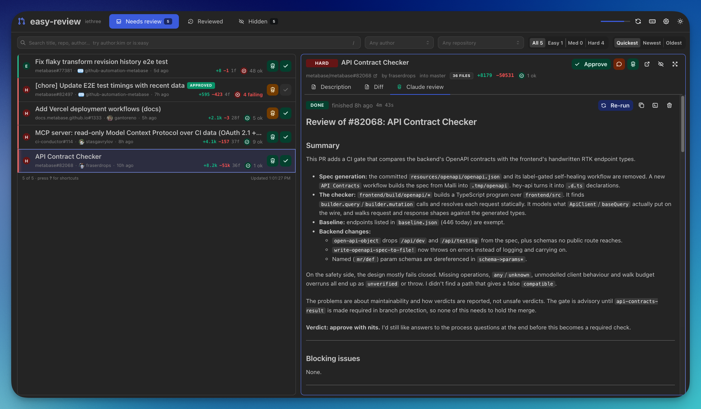

# easy-review

Github's review UI is too slow for the volume of code review I'm doing every day.

This is a fast, multi-paned review UI that uses your local github CLI and claude code CLI for agent review assistance.



- Keyboard shortcuts for fast navigation.
- My PRs: your own open pull requests and the ones assigned to you, for self-review — Claude reviewers and comments (GitHub doesn't let you approve your own).
- Worktrees for multitasking.
- Several Claude reviewers at once — "Security", "Performance", your own — each with its own instructions, kept as Markdown files in `~/.easy-review/reviewers`.

## How to use

```bash
bun install
gh auth login    # if you aren't already signed in
bun run dev      # http://localhost:5175
```

Before you push: `bun run lint`, `bun run typecheck` and `bun test`. CI runs all three on every push to `main` and every pull request (`.github/workflows/checks.yml`).

## The macOS app

```bash
bun run desktop          # run it from source
bun run desktop:build    # package it → dist/desktop/easy-review-<version>-<arch>.dmg and .zip
```

The app is an Electron window around the same server: it runs the compiled server binary and shows it in a native title bar, with menus, and with links that open in your browser. When a Claude review finishes while the app is in the background, macOS tells you; click the notification to open the review. Opened from Finder, it reads your login shell's PATH, so `gh` and `claude` are found where your terminal finds them.

A local build is signed ad hoc, which is enough on the Mac that built it. To sign with a Developer ID, set `CSC_NAME` to a keychain identity, or `CSC_LINK` and `CSC_KEY_PASSWORD` to a .p12 certificate.

### Releases

Every push to `main` publishes a GitHub release (`.github/workflows/release.yml`) with a `.dmg` for Apple silicon and one for Intel. Versions count up by patch within the series in `package.json`: `0.1.0`, `0.1.1`, … — change it to `0.2.0` to start the next series.

Release builds are signed ad hoc, not notarized, so macOS won't open a downloaded copy the first time. Open it from **System Settings → Privacy & Security → Open Anyway**.

### Updates

The app looks for a newer release when it starts, and asks before installing it; **easy-review → Check for Updates…** looks on demand. An update replaces the app where it is, so it has to be somewhere you can write to — your Applications folder, not the disk image.
